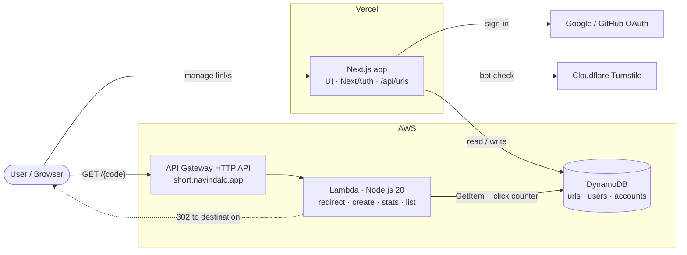

<div align="center">
  <h1>Zipwyn</h1>
  <p>A fast, secure URL shortener with click analytics - a full-stack monorepo combining a Next.js web app on Vercel with a serverless redirect backend on AWS.</p>

<p align="center">
  
  
  
  
  
  
  
</p>

[Live Demo](https://zipwyn.navindalc.app) • [Short Domain](https://short.navindalc.app) • [Report Bug](https://github.com/paradocx96/zipwyn/issues) • [Request Feature](https://github.com/paradocx96/zipwyn/issues)
</div>

---

## Overview

Zipwyn lets users sign in, create short links (with optional custom codes), view click counts and QR codes, and manage
everything from a dashboard. Under the hood it is split into two independently deployable parts that share one DynamoDB
data layer:

| Part                   | Path                       | Runs on                  | Responsibility                                                                                      |
|------------------------|----------------------------|--------------------------|-----------------------------------------------------------------------------------------------------|
| **Web app**            | [`web`](web)               | Vercel                   | Landing site, OAuth sign-in, dashboard, authenticated REST API (`/api/urls`), SEO, security headers |
| **Serverless backend** | [`serverless`](serverless) | AWS Lambda + API Gateway | Public short-link resolution (`302` redirects), click counting, small create/stats/list API         |

Splitting them keeps the latency-sensitive, spiky redirect path on cheap, auto-scaling serverless infrastructure while
the product UI ships through Vercel's Git-driven workflow.

## What This Project Demonstrates

Built as a hands-on showcase of cloud and DevOps practices on a real, live product:

| Area                           | In this repo                                                                                                                                                                                           |
|--------------------------------|--------------------------------------------------------------------------------------------------------------------------------------------------------------------------------------------------------|
| **Infrastructure as Code**     | Lambda functions, HTTP API routes, IAM role and DynamoDB table declared in `serverless.yml` and provisioned through CloudFormation                                                                     |
| **Serverless on AWS**          | API Gateway HTTP API → Lambda (Node.js 20) → DynamoDB `PAY_PER_REQUEST`; scales to zero, no servers to manage                                                                                          |
| **Multi-environment delivery** | Stage-based deploys (`dev` / `prod`) with per-stage resource names and base URLs; Vercel preview and production deployments for the web app                                                            |
| **Custom domains & DNS**       | `zipwyn.navindalc.app` (web) and `short.navindalc.app` (redirects)                                                                                                                                     |
| **Security by default**        | CSP, HSTS, `X-Frame-Options`, `Referrer-Policy`, `Permissions-Policy`; URL scheme allowlist and private-network blocking (SSRF hardening); per-user rate limiting; Cloudflare Turnstile bot protection |
| **Least-privilege IAM**        | Function role limited to specific DynamoDB actions on the stack's table and indexes                                                                                                                    |
| **Cost-aware design**          | On-demand DynamoDB, HTTP API (cheaper than REST API), free-tier-friendly hosting                                                                                                                       |
| **Monorepo tooling**           | pnpm workspace with a single lockfile and root-level scripts for both apps                                                                                                                             |

## Architecture



**Two request paths**

1. **Manage links** - the browser talks to the Next.js app. NextAuth (Google or GitHub, JWT sessions) authenticates the
   user, and API routes validate input, enforce ownership and read/write DynamoDB.
2. **Follow a link** - `short.navindalc.app/{code}` hits API Gateway, which invokes the redirect Lambda. It looks up the
   code, increments the click counter, and returns a `302` with no-cache headers so every click is counted.

## Repository Structure

```
zipwyn/
├── web/                      # Next.js 16 app (App Router, TypeScript, Tailwind CSS 4)
│   ├── src/app/              # Pages and API routes (auth, urls, turnstile)
│   ├── src/components/       # Landing, dashboard, pricing, UI primitives
│   ├── src/lib/              # Auth, DynamoDB client, validation, rate limit, SEO
│   ├── next.config.ts        # Security headers (CSP, HSTS, …)
│   └── README.md
├── serverless/               # AWS serverless backend (Serverless Framework v4)
│   ├── src/handlers/         # Lambda handlers (create, list, stats, redirect)
│   ├── src/lambda/           # Dependency-free variants for manual deployment
│   ├── serverless.yml        # Infrastructure definition
│   └── README.md
├── package.json                  # Root scripts that proxy to each app
├── pnpm-workspace.yaml           # Workspace definition
└── README.md
```

## Tech Stack

| Layer            | Technology                                                                          |
|------------------|-------------------------------------------------------------------------------------|
| Web framework    | Next.js 16 (App Router), React 19, TypeScript 5                                     |
| Styling & motion | Tailwind CSS 4, Framer Motion 12, Lucide icons                                      |
| Authentication   | NextAuth.js 4 - Google & GitHub OAuth, JWT sessions, DynamoDB-backed users/accounts |
| Compute          | AWS Lambda (Node.js 20) behind API Gateway HTTP API                                 |
| Database         | Amazon DynamoDB (on-demand) via AWS SDK v3                                          |
| IaC & deployment | Serverless Framework v4 (CloudFormation), Vercel                                    |
| Bot protection   | Cloudflare Turnstile (optional)                                                     |
| Tooling          | pnpm workspaces, ESLint 9, `sharp` + `next/og` for brand assets                     |

## Features

- **URL shortening** with random 7-character codes (nanoid) or custom codes
- **Click analytics** per link, QR code generation, list and grid dashboard views, search and delete
- **Google & GitHub sign-in**
- **Hardened input handling** - `http(s)` only, private/loopback/link-local hosts blocked, length limits, custom-code
  format rules
- **Light/dark theme** without flash, animated landing page, responsive layout
- **SEO and branding** - Open Graph image, JSON-LD, sitemap, robots, PWA manifest and icons
- **Plan tiers (Free / Pro / Enterprise)** defined in one config file; billing and quota enforcement are not wired up
  yet

---

## Getting Started

### Prerequisites

- **Node.js** 20+
- **pnpm** 9+
- **AWS account** + CLI configured (`aws configure`)
- **OAuth apps** for Google and/or GitHub
- *(Serverless backend only)* a free [Serverless Framework](https://www.serverless.com/) login

### 1. Install

```bash
git clone https://github.com/paradocx96/zipwyn.git
cd zipwyn
pnpm install
```

### 2. Create the DynamoDB tables

The web app expects three tables (names are set in `web/src/lib/dynamodb.ts`). All use on-demand billing.

```bash
# URLs - queried by owner, newest first
aws dynamodb create-table \
  --table-name url-shortener-urls \
  --billing-mode PAY_PER_REQUEST \
  --attribute-definitions AttributeName=shortCode,AttributeType=S \
                          AttributeName=userId,AttributeType=S \
                          AttributeName=createdAt,AttributeType=S \
  --key-schema AttributeName=shortCode,KeyType=HASH \
  --global-secondary-indexes \
    'IndexName=userId-createdAt-index,KeySchema=[{AttributeName=userId,KeyType=HASH},{AttributeName=createdAt,KeyType=RANGE}],Projection={ProjectionType=ALL}'

# Users - looked up by email at sign-in
aws dynamodb create-table \
  --table-name url-shortener-users \
  --billing-mode PAY_PER_REQUEST \
  --attribute-definitions AttributeName=id,AttributeType=S AttributeName=email,AttributeType=S \
  --key-schema AttributeName=id,KeyType=HASH \
  --global-secondary-indexes \
    'IndexName=email-index,KeySchema=[{AttributeName=email,KeyType=HASH}],Projection={ProjectionType=ALL}'

# OAuth accounts
aws dynamodb create-table \
  --table-name url-shortener-accounts \
  --billing-mode PAY_PER_REQUEST \
  --attribute-definitions AttributeName=id,AttributeType=S \
  --key-schema AttributeName=id,KeyType=HASH
```

| Table                    | Partition key   | Secondary index                                   |
|--------------------------|-----------------|---------------------------------------------------|
| `url-shortener-urls`     | `shortCode` (S) | `userId-createdAt-index` (`userId` / `createdAt`) |
| `url-shortener-users`    | `id` (S)        | `email-index` (`email`)                           |
| `url-shortener-accounts` | `id` (S)        | -                                                 |

### 3. Configure the web app

```bash
cp web/.env-example web/.env.local
```

| Variable                                                  | Required | Description                                                                    |
|-----------------------------------------------------------|----------|--------------------------------------------------------------------------------|
| `NEXTAUTH_URL`                                            | Yes      | Base URL of the app (`http://localhost:3000` locally)                          |
| `NEXTAUTH_SECRET`                                         | Yes      | Session signing secret (`openssl rand -base64 32`)                             |
| `GOOGLE_CLIENT_ID` / `GOOGLE_CLIENT_SECRET`               | Yes      | Google OAuth credentials                                                       |
| `GITHUB_CLIENT_ID` / `GITHUB_CLIENT_SECRET`               | Yes      | GitHub OAuth credentials                                                       |
| `AWS_REGION`                                              | Yes      | Region of the DynamoDB tables                                                  |
| `AWS_ACCESS_KEY_ID` / `AWS_SECRET_ACCESS_KEY`             | Yes      | Credentials for an IAM user/role with access to the three tables               |
| `NEXT_PUBLIC_SHORT_URL_DOMAIN`                            | Yes      | Public origin used in returned short URLs (e.g. `https://short.navindalc.app`) |
| `NEXT_PUBLIC_TURNSTILE_SITE_KEY` / `TURNSTILE_SECRET_KEY` | No       | Enables Cloudflare Turnstile; skipped if unset                                 |

### 4. Run

```bash
pnpm dev                 # web app → http://localhost:3000
pnpm dev:serverless      # serverless-offline → http://localhost:3001
```

Root scripts:

| Script                        | What it does                                  |
|-------------------------------|-----------------------------------------------|
| `pnpm dev` / `build` / `lint` | Run the matching script in `web`              |
| `pnpm dev:serverless`         | Run the API locally with `serverless-offline` |
| `pnpm deploy:serverless`      | Deploy the `dev` stage to AWS                 |
| `pnpm deploy:serverless:prod` | Deploy the `prod` stage to AWS                |

---

## Deployment

### Web app - Vercel

1. Import the repository in Vercel and set **Root Directory** to `web`
2. Add the environment variables from the table above
3. Push to deploy - pull requests get preview URLs, the default branch deploys to production

### Serverless backend - AWS

```bash
aws configure --profile zipwyn && export AWS_PROFILE=zipwyn
npx serverless login
pnpm deploy:serverless:prod
```

This creates the CloudFormation stack (HTTP API, four Lambda functions, IAM role, DynamoDB table) in `ap-southeast-1`.
The production redirect domain `short.navindalc.app` is mapped to the HTTP API with an API Gateway custom domain. See [
`serverless/README.md`](serverless/README.md) for endpoints, configuration and teardown.

> **Shared table:** the redirect service must read the same table the web app writes to (`url-shortener-urls`). The
> standalone handlers in `serverless/src/lambda` are wired to that name directly; the Serverless Framework stack
> creates stage-suffixed tables by default. Aligning these into a single source of truth is on the roadmap below.

---

## Security

- **Transport & headers** - HSTS (2 years, preload), strict CSP limited to self and Cloudflare Turnstile,
  `X-Frame-Options: DENY`, `X-Content-Type-Options: nosniff`, restrictive `Permissions-Policy`, `X-Powered-By` removed
- **Input validation** - scheme allowlist, blocked localhost/metadata hosts and private IP ranges, 2,048-character URL
  limit, `^[A-Za-z0-9_-]{3,20}$` custom codes
- **Authorization** - every link operation checks that the signed-in user owns the record (`403` otherwise)
- **Abuse controls** - per-user rate limit on link creation (`429` with `Retry-After`); optional Turnstile verification
- **Secrets** - environment variables only; `.env*` and `.aws/` are git-ignored

## Roadmap

**Delivered**

- [x] Serverless redirect backend defined as code
- [x] Multi-stage deploys and custom domains
- [x] Hardened headers, validation and rate limiting
- [x] Git-driven web deployments on Vercel

**Planned - platform & DevOps**

- [ ] GitHub Actions CI for lint, type-check and build on every pull request
- [ ] GitHub Actions CD for the serverless stack using AWS OIDC (no long-lived keys)
- [ ] Replace static AWS keys in the web app with short-lived credentials (Vercel OIDC → IAM role)
- [ ] Define all DynamoDB tables and indexes in one IaC stack, shared by both apps
- [ ] CloudWatch alarms and dashboards (5xx, throttles, latency); structured logging
- [ ] Custom domain and ACM certificate managed as code
- [ ] Per-function least-privilege IAM and AWS WAF on the HTTP API
- [ ] Distributed rate limiting (the current limiter is in-memory per instance)
- [ ] Docker Compose with DynamoDB Local for one-command local development
- [ ] Automated tests (validation unit tests, API integration tests)

**Planned - product**

- [ ] Billing and plan quota enforcement
- [ ] Link expiration, bulk creation and richer analytics (referrers, geography, devices)

---

## Author

**Navinda Chandrasiri** - [@paradocx96](https://github.com/paradocx96)

## License

Copyright © 2026 Navinda Chandrasiri. All rights reserved.
